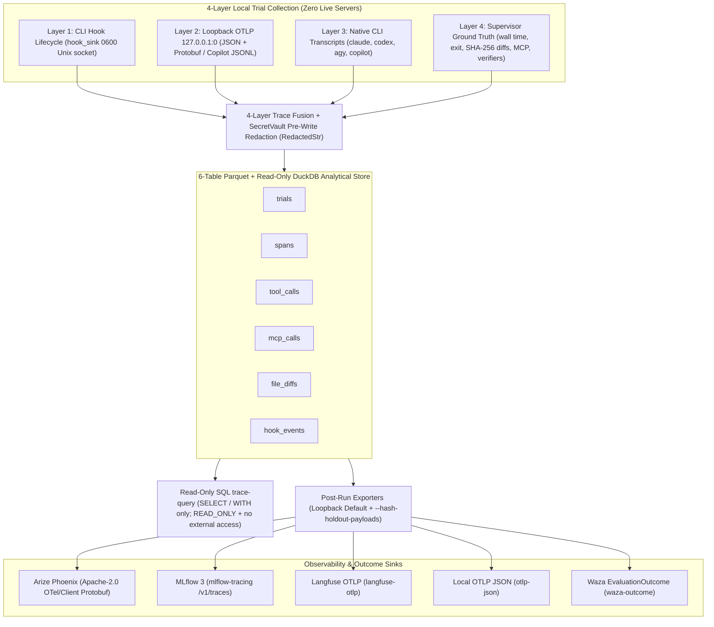
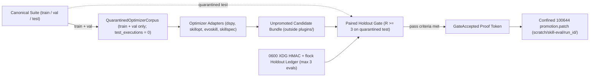

# `artagon-skills-eval`

Subscription-first, multi-CLI Agent Skill and harness evaluation platform, static `SKILL.md` linter, 4-layer trace store, and decoupled optimizer/observability adapter workspace.

> **Current Status & Roadmap (Phase-0 Bootstrap vs. OpenSpec Phases 1–5)**
>
> - **Shipped today (Phase-0 foundation):** root umbrella (`artagon-skills-eval`) plus 8 `uv` workspace members (`artagon-eval-core`, `artagon-eval-skills`, and 6 lazy `Pluggy` adapter packages); strict `FrozenModel` + `Expression 6.0.1` + `rpds-py` + capability-sealed `RedactedStr` + 11-variant `EvalError` ADT; `agentskills.io` `skills-ref` (`0.1.1`) Tier-0 `skill-lint` and `skill-eval lint`; lazy `Pluggy` adapter discovery (`harness-eval adapters`, `skillopt-runner`); `harness-eval-nix-check`; single canonical `data/` (10 Draft 2020-12 JSON schemas, 5 harness YAMLs, `providers.json`, `keychain-services.json`); 53 Hypothesis property tests (86 total workspace tests); 5 `ast-grep` rules; 6 `import-linter` contracts; locked `flake.nix` (`nixos-26.05`); and OpenSpec `spec-driven-evidence` governance.
> - **In progress (Phases 1–5):** Full multi-CLI campaign execution, 4-CLI transcript decoders, multiplexers, DuckDB/Parquet trace store, OTLP exporters, Tier-1/Tier-2 skill linters, PyYAML suite generators, paired holdout gate/promotion workflows, full implementations of the 6 optional adapters, standalone multi-CLI plugin/APM manifests, and `v0.2.0` release packaging are specified and tracked in [openspec/changes/implement-eval-workspace-phases-1-5/](openspec/changes/implement-eval-workspace-phases-1-5/proposal.md).

## Contents

- [1. Overview: Skill Eval vs. Harness Eval](#1-overview-skill-eval-vs-harness-eval)
- [2. Skill Evaluation (`artagon-eval-skills`)](#2-skill-evaluation-artagon-eval-skills)
- [3. Harness Evaluation (`artagon-eval-core`)](#3-harness-evaluation-artagon-eval-core)
- [4. 4-Layer Tracing & Observability](#4-4-layer-tracing--observability)
- [5. Evaluation & Scientific Methodologies](#5-evaluation--scientific-methodologies)
- [6. Pluggable Adapters & Workspace Packages](#6-pluggable-adapters--workspace-packages)
- [7. Engineering Standards](#7-engineering-standards)
- [8. Quickstart, CLI Entrypoints, Nix & Verification](#8-quickstart-cli-entrypoints-nix--verification)
- [9. OpenSpec Workflow & Documentation](#9-openspec-workflow--documentation)

---

## 1. Overview: Skill Eval vs. Harness Eval

`artagon-skills-eval` separates **Agent Skill evaluation** from **multi-CLI harness evaluation** into two layered packages with distinct billing policies and responsibilities.

| Dimension | Skill Eval (`skill-eval`, `skill-lint`) | Harness Eval (`harness-eval`) |
| --- | --- | --- |
| Package | `artagon-eval-skills` | `artagon-eval-core` |
| Primary goal | Lint, generate, benchmark, optimize, holdout-gate, and promote `SKILL.md` suites. | Execute isolated multi-CLI campaigns, fuse 4-layer traces, run blind judging, and analyze treatment lift. |
| Evaluation surface | `surface: "skill_eval"` | `surface: "general"` (or `skill_eval` when invoked by `skill-eval`) |
| Billing & auth policy | **Unconditionally subscription-only.** Any `auth_mode: "api_key"` arm or `--allow-api-keys` flag fails closed (`exit 4`, `api_keys_not_allowed`). | **Subscription-first default.** Permits opt-in `auth_mode: "api_key"` only on `surface: "general"` with `--allow-api-keys` and a `FiniteBudget`. |
| Supported CLIs | `claude`, `codex`, `agy`, `copilot` | `claude`, `codex`, `agy`, `copilot` (`grok` catalog-only) |
| Key artifacts | `evals.json`, `trigger-evals.json`, generated `eval.yaml`, `holdout_ledger.json`, confined `100644` `promotion.patch`. | `protocol.json`, `frozen.json`, RFC 8785 MCP cassettes, 6-table Parquet/DuckDB store, `summary.json`, OTLP exports. |
| Phase-0 status | Shipped: `skill-eval version`, `skill-eval lint`, `skill-lint` (Tier-0 `skills-ref`). Remaining lifecycle tracked in Phase 3. | Shipped: `harness-eval version`, `harness-eval adapters`, `harness-eval-nix-check`, `skillopt-runner`. Full runtime tracked in Phases 1–2. |

---

## 2. Skill Evaluation (`artagon-eval-skills`)

`artagon-eval-skills` validates portable `SKILL.md` bundles, compiles declarative skill eval suites, orchestrates subscription-only optimization, and enforces paired holdout promotion gates.

### 3-Tier `SKILL.md` Linting Pipeline

| Tier | Scope | Implementation & Status |
| --- | --- | --- |
| **Tier 0** | Official `agentskills.io` specification compliance: UTF-8 BOM handling, uppercase `SKILL.md`, strict YAML frontmatter (`name`, `description`, `license`, `compatibility`, `allowed-tools`, `metadata`), and directory-name parity. | **Shipped (Phase 0).** Delegates exclusively to official `skills-ref` (`0.1.1`) inside `artagon_eval_skills.spec_adapter`, producing frozen `SkillFrontmatter` (enforced by `import-linter`). |
| **Tier 1** | Portability budgets (character/token limits), hidden or bidirectional Unicode detection, and `SecretVault` / `detect-secrets` credential scanning. | Tracked in Phase 3 (`artagon_eval_skills.lint`). |
| **Tier 2** | Native multi-client plugin manifest parity (`.claude-plugin`, `.codex-plugin`, `.copilot-plugin`, `apm.yml`) and `artagon/skill-evals/v2` suite contracts. | Tracked in Phase 3 (`artagon_eval_skills.lint`). |

### Eval Suite Anatomy

Skill suites separate trigger accuracy, behavioral outcomes, and split assignments into versioned files:

- **`evals.json`**: Task prompts, expected outputs, and deterministic assertions/expectations (`artagon/skill-evals/v2`).
- **`trigger-evals.json`**: Positive and negative activation cases measuring skill selection precision and recall.
- **`execution-evals.json`**: Additive end-to-end execution fixtures bound to deterministic workspace verifiers.
- **Generated Waza `eval.yaml`** (plus `tasks/*.yaml`, `trigger_tests.yaml`, `tasks.skillopt.json`): Emitted deterministically with PyYAML (`--check` detects drift with `mutations: "none"`). Generated Waza configs emit `model: default` so model resolution stays dynamic and never hardcodes stale model identifiers.
- **Canonical splits, families, and criticality**: Every case declares a split normalized by one core parser (`parse_task_split`):
  - `train` (alias `development`): Visible to optimizers and iterative reflection.
  - `val` (alias `selection`): Used for candidate selection and non-regression checks.
  - `test` (alias `holdout`): Strictly quarantined from all optimizers and reserved for the paired promotion gate.
  - Cases carry `task_family` tags for stratified analysis and `critical` flags that enforce zero-regression protection at the gate.

### Skill Evaluation Lifecycle (Phase 3 Target)

```text
generate -> lint -> select -> run / bench -> optimize -> gate -> promote -> report -> purge-*
```

1. **`generate`**: Emit Waza and SkillOpt suite artifacts from canonical `evals.json` / `trigger-evals.json` (`--check` for CI drift verification).
2. **`lint`**: Run Tier-0 (`skills-ref`, shipped today), Tier-1 (portability/security), and Tier-2 (manifest/contract parity) checks.
3. **`select`**: Validate split integrity (`train`/`val`/`test`) and prepare quarantined corpora without exposing `test` cases.
4. **`run` / `bench`**: Execute paired subscription-only trials through `harness-eval` or benchmark adapters (`waza`, `skillspec`).
5. **`optimize`**: Run proposal-only adapters (`dspy-gepa`, `optimize-anything`, `pydsp`, `skillopt`, `evoskill`, `skillspec`) strictly on `train` + `val`, emitting unpromoted candidate bundles outside `plugins/`.
6. **`gate`**: Evaluate a candidate against baseline on quarantined `test` holdout cases under `flock`-guarded ledger limits (`<= 3` evaluations per `(skill_id, test_digest)`).
7. **`promote`**: Emit a confined `100644` regular-file `promotion.patch` under `0700` `scratch/skill-eval/<run_id>/` **only** when holding a `GateAccepted` proof token. Never auto-mutates `plugins/` or production skills.
8. **`report` & `purge-*`**: Render campaign diagnostics and remove scratch run directories together with per-campaign HMAC keys (`purge-campaign`).

### External Repository Targeting & 4-Layer Config Overlays

Both `skill-eval` and `harness-eval` target arbitrary external Agent Skill repositories with zero hardcoded monorepo paths via `--repo-root`, `--config-dir`, `--skills-dir`, and `--work-dir`. Configuration resolves through four immutable `PersistentMap` overlay layers ordered from lowest to highest precedence (later layers override earlier ones; malformed target-repo overlays fail closed with `exit 2` instead of silently falling back):

1. **Packaged Defaults**: Canonical JSON schemas, 5 harness YAMLs, `providers.json`, and `keychain-services.json` loaded via `importlib.resources`.
2. **Operator Local Model Caches & Env**: Local Codex `models_cache.json`, NTM `config.toml`, and `HARNESS_EVAL_*` environment defaults supplementing packaged catalogs.
3. **Target Repository Overlays & Protocol Manifests**: Optional repo-local inventory, rubric, protocol, or harness overrides under `--repo-root` / `--config-dir`.
4. **Explicit CLI Flags**: Per-invocation flags (`--arm-override`, `--skills-dir`, `--work-dir`), which hold highest precedence over ambient caches and repository overlays.

---

## 3. Harness Evaluation (`artagon-eval-core`)

`artagon-eval-core` provides the lower-level multi-CLI execution engine, capability catalog, auth/billing guards, hermetic Nix/workspace isolation, and MCP replay layer ([ADR-0006](docs/adr/0006-staged-locked-nix-environment.md), [ADR-0009](docs/adr/0009-harness-eval-dual-auth-and-keychain-separation.md), [ADR-0010](docs/adr/0010-harness-eval-ephemeral-cao-and-tmux-isolation.md), [ADR-0012](docs/adr/0012-standalone-capability-driven-artagon-harness-eval.md)).

### Capability-Driven Multi-CLI Execution

Vendor CLI differences live in declarative YAML manifests under `packages/artagon-eval-core/src/artagon_eval_core/data/harnesses/` with `packaging` SemVer `SpecifierSet` version overlays rather than hardcoded Python branches:

- **Active evaluation harnesses (4):** `claude`, `codex`, `agy`, `copilot`.
- **Catalog-only harness (1):** `grok` (`campaign_v1_supported: false`, `skillopt_supported: false`).
- **Execution modes (4):**
  - `headless` (Tier-1): Direct subprocess execution through the single-exec trampoline (`shim-exec.json` `O_CREAT|O_EXCL`).
  - `ntm` (Tier-2): Private per-trial `tmux` server (`TMUX_TMPDIR=<trial>/tmux`, `-L art-eval`, `-f <trial>/tmux.conf`) running `bash --noprofile --norc` (`rc-free-bash`) so operator dotfiles never re-inject API keys.
  - `herdr` (Tier-2): Isolated `HOME=<trial>/pane-home` (`unsetopt GLOBAL_RCS`) with `--no-brief`.
  - `cao` (Tier-2): Ephemeral bearer-authenticated `cao-server` on `127.0.0.1:0` backed by per-trial SQLite and profiles, leaving any operator `cao-server` on `127.0.0.1:9889` untouched.

### Dynamic Model & Effort Resolution

Model and effort settings resolve dynamically at `preflight` / `freeze` time in strict precedence order:

```text
--arm-override -> protocol manifest -> HARNESS_EVAL_* env -> NTM config.toml -> Codex models_cache.json -> packaged providers.json seed
```

- Supported `EffortLevel` values: `low | medium | high | xhigh | max | ultra` (filtered per harness capability).
- Domain `ModelId` rejects sentinel strings (`""`, `"default"`, `"auto"`) in favor of `Option` (`Nothing`) until resolved.
- At `freeze` time, resolved concrete model identifiers, binary paths, cassette SHA-256 digests, and RNG seeds pin immutably into `frozen.json`.

### Dual Authentication & Billing Guards

[ADR-0009](docs/adr/0009-harness-eval-dual-auth-and-keychain-separation.md) (narrowed on `surface: "skill_eval"` by [ADR-0016](docs/adr/0016-unified-subscription-skill-eval-and-adapter-architecture.md)) enforces fail-closed separation between signed-in subscriptions and metered API billing:

| Auth Mode | Allowed Surfaces | Gate & Budget Requirements | Secret & Keyring Handling |
| --- | --- | --- | --- |
| `subscription` (default) | `general`, `skill_eval` | None. Default on every arm. | Scrubs all `METERED_BILLING_ENV_VARS` and metered prefixes (`ANTHROPIC_BEDROCK_*`, `ANTHROPIC_VERTEX_*`, `COPILOT_PROVIDER_*`) in supervisor and trampoline (`exit 4` on violation). Requires OS keyring store separation (locked macOS `.keychain-db`, Linux `pass` or locked Secret Service collection; otherwise stamps `billing_guard: "env_only"` and requires OS containers for scored shell trials). On Linux, routes Secret Service lookups through a per-trial read-only method-only `xdg-dbus-proxy` (`/tmp/art-dbus-<rand>/bus`, `< 100` bytes; omits `--talk=org.freedesktop.secrets` and `Service.Unlock`). |
| `api_key` (opt-in) | `general` **only** (refused with `exit 4` on `skill_eval`) | Manifest declaration **and** `--allow-api-keys` CLI flag **and** `FiniteBudget` (`max_cost_usd > 0` or `max_tokens > 0`). | Stages the secret in a `0400` `<trial>/secret/api_key` file read by the pre-exec trampoline and unlinked before trial completion. Projects zero subscription OAuth state or keyring IPC (`KEYCHAIN_DISABLE=1`, empty `DBUS_SESSION_BUS_ADDRESS`). |

### Isolation & Reproducibility

- **Staged Locked Nix Closure ([ADR-0006](docs/adr/0006-staged-locked-nix-environment.md)):** Root [flake.nix](flake.nix) pins `nixos-26.05` (`flake.lock` + [nix/locked-versions.json](nix/locked-versions.json)), applies `lib.fileset.toSource` clean-source slicing, runs an eval-time forbidden-file guard blocking `.env`, `.venv`, `.beads`, `.ntm`, `scratch`, `logs`, `candidates`, `results`, `holdouts`, `private`, and `auth`, and pairs with an `O_NOFOLLOW` `0700` host stager so private state never enters `/nix/store/`.
- **Hot-Path Shim Isolation ([ADR-0012](docs/adr/0012-standalone-capability-driven-artagon-harness-eval.md)):** Subprocess shims (`artagon_eval_core.shims.{wire,scrub,trampoline,hook_sink}`) execute via `python -P -s -m` (immune to workspace `cwd` `sys.path[0]` shadowing), import **only** the Python standard library and optional `msgspec` (enforced by `import-linter`), and satisfy a fresh-subprocess overhead budget of `<= 5ms` above bare `python -P -s -c pass`.
- **Private Workspaces & Ancestor Hygiene:** Every trial runs in a fresh `0700` directory under `/var/tmp/art-eval-<uid>/` outside the repository. Ancestor scanning to `/` and fixture quarantine prevent ambient `CLAUDE.md`, `AGENTS.md`, `.claude`, `.codex`, `.gemini`, or `.copilot` files from contaminating trials.
- **RFC 8785 Deterministic MCP Cassettes:** Stdio Model Context Protocol traffic (`harness-eval-cassette/v1`) replays offline without network access. Requests normalize physical paths to `${WS}` and `${TRIAL_ROOT}`, canonicalize JSON with RFC 8785 JCS (with exact `uint64` fallback above `2**53 - 1`), pop repeated tool responses in FIFO order, and record unmatched calls as `cassette_miss` in `mcp_calls.jsonl`.
- **Observer Separation:** Operator skills (`harness-eval`, `harness-eval-author`, `harness-eval-trace`) stay in the operator CLI and are stripped from subject skill staging unless explicitly named under test.

---

## 4. 4-Layer Tracing & Observability

No single telemetry stream captures complete, tamper-evident behavior across all four CLIs. [ADR-0011](docs/adr/0011-harness-eval-four-layer-trace-and-duckdb-store.md) collects four complementary local layers during trials with near-zero overhead and zero live server dependencies, scrubs secrets and PII pre-write through `SecretVault`, and compacts normalized traces into a 6-table Parquet + read-only DuckDB analytical store.

### The 4 Fused Trace Layers

| Layer | Collector / Source | Captured Evidence |
| --- | --- | --- |
| **1. CLI Hook Lifecycle** | `hook_sink` (`artagon_eval_core.shims.hook_sink`) over an out-of-workspace `0600` Unix socket (`/tmp/art-htrc-<rand>/sock`) with per-trial HMAC `O_APPEND` fallback and `<= 5s` `exit 0` watchdog. | Exact monotonic nanosecond tool, session, compaction, permission, model-request, subagent, and point-in-time lifecycle boundaries (`SessionStart`/`SessionEnd`, `PreInvocation`/`PostInvocation`, `UserPromptSubmit`, `PreToolUse`/`PostToolUse`/`PostToolUseFailure`, `PreCompact`/`PostCompact`, `PermissionRequest`/`PermissionResult`/`PermissionDenied`, `PreModelRequest`/`PostModelRequest`, `SubagentStart`/`SubagentStop`, `Stop`/`StopFailure`/`Interrupt`/`ErrorOccurred`) compiled across 4 vendor wire codecs (`nested_matcher_groups`, `namespaced_lifecycle`, `versioned_flat_map`, `event_array`) with zero prompt perturbation. CLI-verified hook counts: `claude` 28, `codex` 14, `copilot` 14, `agy` 6. |
| **2. Loopback OTLP GenAI** | In-process bearer-authenticated `127.0.0.1:0` OTLP/HTTP JSON + protobuf collector (`claude`, `codex`) plus direct JSONL file ingestion (`copilot` `COPILOT_OTEL_FILE_EXPORTER_PATH`). | `invoke_agent`, `chat`, and `execute_tool` spans, Time To First Token (`TTFT`), and input/output/cache-read/reasoning token counts. |
| **3. Native Per-CLI Transcripts** | Per-CLI decoders (`claude` `stream-json`, `codex` `rollout-*.jsonl`, `agy` `transcript_full.jsonl`, `copilot` JSON/events JSONL). | Tool calls, internal assistant responses, and bounded (`<= 256 KiB`), redacted `final_output_text` (excluding tool arguments and tool outputs). |
| **4. Supervisor Ground Truth** | Trial supervisor (`shim-exec.json`, `child-execs.jsonl`, `mcp_calls.jsonl`, pre/post workspace tree snapshots, verifier runners). | End-to-end wall time, process exit codes, SHA-256 workspace `file_diffs` (catching shell edits invisible to file-edit tools), MCP cassette match tiers (`exact`, `normalized`, `match_keys`, `default_response`, `protocol`, `miss`), and deterministic verifier verdicts. |

### Trace Collection, Redaction, Storage & Export Architecture



### 6-Table Parquet / DuckDB Analytical Store

Compacted campaigns materialize six Parquet views (`trials`, `spans`, `tool_calls`, `mcp_calls`, `file_diffs`, `hook_events`) with a read-only SQLite fallback in bare-host mode:

- **`trials`**: One row per trial (`trial_id`, `arm_id`, `task_id`, `block_id`, `harness`, `model`, `observed_model`, `auth_mode`, `execution_mode`, `status`, `exit_code`, `verified_success`, `judge_score`, `redaction_applied`, `duration_ms`, token totals, `ttft_ms`, call/miss/diff counts).
- **`spans`**: Correlated OTel/hook/transcript/supervisor waterfall spans including derived paired `hook_lifecycle` and `subagent` spans (`trace_id`, `span_id`, `parent_span_id`, `span_kind`, `source_layer`, timestamps, `duration_ms`, `ttft_ms`, redacted `attributes_json`).
- **`tool_calls`**: Normalized per-trial tool invocations (`tool_name`, `source_layer`, `duration_ms`, `status`, redacted `arguments_json`, `result_summary`).
- **`mcp_calls`**: JSON-RPC MCP traffic (`server_name`, `method`, `tool_name`, `exact_jcs_sha256`, `normalized_jcs_sha256`, `match_tier`, `cassette_miss`, `is_error`, `duration_ms`).
- **`file_diffs`**: Pre/post workspace SHA-256 digests and byte lengths (`rel_path`, `change_kind`: `added|modified|deleted`).
- **`hook_events`**: Normalized, pre-scrubbed Layer-1 hook records (`event_index`, `event_name`, `lifecycle_kind`, `recv_wall_ns`, `recv_mono_ns`, `transport`, `truncated`, `tool_name`, `tool_use_id`, `turn_id`, `agent_id`, `session_id`, `status`, redacted `payload_json`).

`trace-query` opens DuckDB with `access_mode='READ_ONLY'` and `enable_external_access=false`, accepting only a single `SELECT` or `WITH` statement. DDL, DML, `COPY`, `ATTACH`, `INSTALL`, `LOAD`, `PRAGMA`, and file-reading table functions (`read_parquet`, `read_csv`) fail closed with `exit 2`.

### Observability Exporters & License Guard

Post-run telemetry sinks live in the decoupled `artagon-eval-observability` and `artagon-eval-waza` Pluggy adapters ([ADR-0016](docs/adr/0016-unified-subscription-skill-eval-and-adapter-architecture.md)):

- **Arize Phoenix (`phoenix`)**: Exports `ExportTraceServiceRequest` (`application/x-protobuf`) with exact `bytes.fromhex()` 16-byte trace / 8-byte span IDs, root-span OTLP `Span.Event` (`hook.<event_name>`) hook telemetry, and OpenInference skill metadata. Uses **strictly Apache-2.0 packages** (`arize-phoenix-otel`, `arize-phoenix-client`, `openinference-semantic-conventions`). The non-OSI `Elastic-2.0` `arize-phoenix` server package and `arize-phoenix-evals` are **explicitly banned** by the 4-step SPDX license guard (`MIT`, `Apache-2.0`, `BSD-2/3-Clause`, `0BSD`, `ISC`, `PSF-2.0`, `MPL-2.0`, `Zlib`, `Unlicense` allowlist).
- **MLflow 3 (`mlflow`)**: Sends standard OTLP `/v1/traces` (including root-span `Span.Event` hook telemetry) with `x-mlflow-experiment-id` via `mlflow-tracing` (plus optional `mlflow-skinny`).
- **Langfuse OTLP (`langfuse-otlp`)**, **Local OTLP JSON (`otlp-json`)** (both carrying root-span `Span.Event` hook telemetry), and **Waza `EvaluationOutcome` (`waza-outcome`)** (with optional relative `0700` redacted workspace snapshots).
- **Export & Holdout Protections**:
  - Network `--endpoint` values enforce loopback-only destinations (`127.0.0.1`, `localhost`, `[::1]`) by default unless remote export is explicitly authorized.
  - Exporters fail closed (`exit 5`, `unredacted_trace_export`) if `redaction_applied` is missing or `False`.
  - Raw `test`/`holdout` traces are refused across all 5 formats (`exit 5`, `holdout_split_contaminated`) unless `--hash-holdout-payloads` replaces text payload fields (including `hook_events` and root-span `Span.Event` `hook.payload` without truncating digests) with supervisor `hmac-sha256:<hex>` digests.
  - Offline scoring (`score_offline`) executes zero live LLM calls (`predict_fn_used: Literal[False]`).

---

## 5. Evaluation & Scientific Methodologies

[ADR-0005](docs/adr/0005-scientific-evidence-admission.md), [ADR-0015](docs/adr/0015-waza-and-dspy-gepa-harness-eval-bridges.md), and [ADR-0016](docs/adr/0016-unified-subscription-skill-eval-and-adapter-architecture.md) define a reproducible experimental methodology designed to prevent temporal drift, cherry-picking, self-judging bias, and holdout overfitting.

### Experimental Design

- **Single-factor arm 4-tuples**: Each arm freezes (`harness_config`, `mcp_servers`, `skills`, `system_prompt`) and varies one experimental factor against `arms[0]` (baseline control).
- **Counterbalanced block schedules**: Seeded **ABBA**, **BAAB**, and **Randomized Complete Block (RCB)** schedules interleave baseline and treatment arms on identical fixtures so time-of-day latency, cache warming, and provider quota drift cancel across arms.
- **Immutable `frozen.json` manifests**: `DraftProtocol -> ResolvedProtocol -> FrozenManifest` pins resolved binaries, models, fixture/verifier/cassette SHA-256 digests, and block seeds before any trial starts. `FrozenManifest` exposes zero mutation or override methods.

### Statistical Analysis (Intention-to-Treat)

- **Intention-to-Treat (`ITT`) denominator**: Every scheduled trial stays in the denominator. Crashes, timeouts, and `VerifierFailed` trials score `0.0` rather than being dropped post-hoc.
- **Whole-block `QuotaCensored` accounting**: If rate limiting or subscription quota exhaustion (`HTTP 429`) hits any trial in a block, the entire paired block is marked `QuotaCensored` so quota drift never biases one arm. When `> 20%` of blocks are quota-censored, the campaign exits `7` (`QuotaCensoredError`, `inconclusive_quota_censored`) and optimizers abort without substituting `0.0` Pareto scores (`CampaignAbortLatch`).
- **Inference & multiplicity control**: Campaigns compute paired bootstrap 95% confidence intervals, paired permutation tests, **Holm-Bonferroni** family-wise error correction across multi-arm comparisons, and `cassette_miss` sensitivity breakdowns separating fixture gaps from model failures.

### Two-Stage Grading & Vendor-Blind Judging

1. **Stage 1a — Deterministic Workspace Verifiers**: Objective exit-code verifiers (`verifier_cmd` / `verifier_path`, exit `0` pass) run against the post-trial workspace (`WAZA_WORKSPACE_DIR`) and normalized final response (`WAZA_OUTPUT_PATH`) with scrubbed stdout/stderr.
2. **Stage 1b — Post-Fusion `trace_assertions`**: Evaluates six deterministic behavioral and output checks over fused traces (`skill_invocation`, `action_sequence`, `behavior`, `output_regex`, `output_keyword`, `output_json_schema`) and combines them with Stage 1a into `verified_success`.
3. **Stage 2 — Optional Vendor-Blind & Billing-Blind Judging**:
   - **Strict vendor-family recusal**: Either a single judge disjoint from every evaluated arm's harness and model vendor family (`claude` -> `anthropic`, `codex` -> `openai`, `agy` -> `google`, `copilot` -> `github_copilot` + routed model family), **or** a `>= 3`-member `judge.panel` guaranteeing `>= 2` eligible non-overlapping judges spanning `>= 2` distinct LLM vendor families per trial (re-checked against runtime `observed_model`; `exit 2`, `judge_vendor_conflict` otherwise). Non-recused panel scores combine via deterministic median aggregation.
   - **Sanitization & canary enforcement**: Clean `GIT_INDEX_FILE` diffs strip harness metadata directories (`.claude`, `.codex`, `.gemini`, `.copilot`, `.ntm`, `.herdr`, `trace/`); vendor, model, billing, and trial tokens are scrubbed with baseline-fixture awareness; any planted canary leak into a judge prompt aborts scoring with `exit 5` (`IsolationTamperError`).

### Anti-Overfitting & Holdout Promotion Gate



- **Compile-time & runtime holdout quarantine**: Distinct `TrainEvalCase`, `ValEvalCase`, and `TestEvalCase` types prevent `test` cases from entering optimizer interfaces. Every optimizer accepts only `QuarantinedSuiteSplit` / `QuarantinedOptimizerCorpus` and emits an `OptimizerReceipt` with `test_executions: Literal[0] = 0`.
- **Safe candidate mutation**: Toolless reflection (`reflect_no_tools`) strips all approval-bypass flags, fences redacted trajectory feedback (`ASI`) in random-nonce `<UNTRUSTED_TRAJECTORY_DATA>`, and confines edits to `SKILL.md` and `references/*.md`. Tool-enabled `EvoSkill` Evolver sessions require a default-deny OS kernel read-allowlist sandbox (`os_sandbox_active == True`, failing closed with `exit 5` if unavailable).
- **Non-keyring `0600` XDG HMAC custody & `<= 3` holdout cap**: Per-campaign 32-byte CSPRNG keys and the long-lived `ledger.key` live solely in `0600` files inside `0700` `$XDG_STATE_HOME/artagon-harness-eval/hmac/` (outside host/trial keyrings and trial `/var/tmp` roots). `holdout_ledger.json` updates under `flock(LOCK_EX)` + atomic `os.replace` and blocks holdout reuse past `3` `gate` evaluations per `(skill_id, test_digest)` (`exit 5`).
- **Paired holdout gate (`R >= 3`) & `GateAccepted` promotion proof**: Admission requires paired holdout runs (`R >= 3`) meeting all four criteria:
  1. Pooled net gain `>= min_gain`.
  2. `0` negative lane-repeat regressions.
  3. `0` critical-case regressions.
  4. Selection (`val`) non-regression.
- **Confined promotion artifact**: The gate returns a closed `GateAccepted | GateRejected | GateBlocked` ADT. `PromotionPatch` constructs **only** from `GateAccepted`, writing a regular `100644` text patch at `scratch/skill-eval/<run_id>/promotion.patch` strictly outside `plugins/`. `GateRejected` exits `1` with zero patch output.

### Normative Exit Codes & Zero-Silent-Failure Contract

Every pure domain function and typed Effect `Protocol` returns `EvalResult[T] = Result[T, EvalError]` over a closed 11-variant `EvalError` ADT projected 1-to-1 onto `NormativeExitCode` via exhaustive `match`/`assert_never`. Every failure writes a unified `harness-eval-envelope/v1` JSON payload (`OkEnvelope` / `ErrEnvelope`) to `stdout` and **always** emits `SecretVault`-scrubbed `structlog` diagnostics (`reason_code`, `exit_code`, `error`, `log_paths`) to `stderr` so `stdout >/dev/null` can never hide failures.

| Exit Code | Enum Constant | `EvalError` Variant | Meaning |
| --- | --- | --- | --- |
| `0` | `OK` | — | Command succeeded (`OkEnvelope`). |
| `1` | `GATE_REJECTED` | `GateRejectedError` | Holdout promotion gate rejected candidate; zero patches emitted. |
| `2` | `SCHEMA_USAGE` | `SchemaUsageError` | Schema validation failed, invalid overlay/SQL/lint spec, or judge vendor conflict. |
| `3` | `CREDENTIAL_UNAVAILABLE` | `CredentialUnavailableError` | Subscription session or requested keyring credential unavailable. |
| `4` | `BILLING_GUARD` | `BillingGuardError` | Metered API/BYOK env leaked in `subscription` mode, `api_key` attempted on `skill_eval`, or missing `--allow-api-keys`/finite budget. |
| `5` | `ISOLATION_TAMPER` | `IsolationTamperError` | Ancestor contamination, path escape, holdout ledger cap (`> 3`), unredacted/holdout trace export, missing kernel sandbox, or canary leak. |
| `6` | `VERIFIER_CASSETTE` | `VerifierCassetteError` | Verifier contract failure, reflection process failure, or `cassette_miss` threshold exceeded. |
| `7` | `QUOTA_CENSORED` | `QuotaCensoredError` | Whole-block rate-limit/quota censoring exceeded `20%` (`inconclusive_quota_censored`). |
| `8` | `MULTIPLEXER` | `MultiplexerError` | Tier-2 `ntm`, `herdr`, or ephemeral `cao-server` multiplexer failure. |
| `64` | `CLI_USAGE` | `CliUsageError` | Invalid CLI flag combination or unsupported subcommand mode. |
| `65` | `DATA_SPLIT_ERROR` | `SplitDataError` | Unknown or malformed task split label (`train|val|test` and aliases). |
| `69` | `ADAPTER_UNAVAILABLE` | `AdapterUnavailableError` | Optional Pluggy adapter not installed or contract mismatch; prints install extra hint. |

---

## 6. Pluggable Adapters & Workspace Packages

External benchmark, optimizer, and observability integrations live in six independent workspace packages registered lazily through `Pluggy` and `importlib.metadata` entry points (`artagon_eval.benchmarks`, `artagon_eval.optimizers`, `artagon_eval.sinks`). Core and skills never import adapter packages directly, and adapters never import one another (enforced mechanically by `import-linter`). Missing adapters fail closed with `exit 69` (`AdapterUnavailableError`).

| Package | Distribution & Extra | Pluggy Entry Points | Responsibility |
| --- | --- | --- | --- |
| Root umbrella | `artagon-skills-eval` (`[all-adapters]`) | — | Unified CLI entrypoints (`harness-eval`, `skill-eval`, `skill-lint`, `skillopt-runner`, `harness-eval-nix-check`) and optional adapter extras |
| [packages/artagon-eval-core](packages/artagon-eval-core/pyproject.toml) | `artagon-eval-core` (core) | Hookspecs & registry | Pure frozen domain models, `Expression 6.0.1`, `rpds-py`, `RedactedStr`, Effect `Protocol` ports, `SecretVault`, `structlog`, ADR-0012 hot-path shims, canonical `data/`, and `harness-eval` CLI |
| [packages/artagon-eval-skills](packages/artagon-eval-skills/pyproject.toml) | `artagon-eval-skills` (core) | — | Isolated `agentskills.io` `skills-ref` Tier-0 adapter, layered linters, `eval-v2` contracts, PyYAML generators, holdout gate/promote workflows, `skill-eval` & `skill-lint` CLIs |
| [packages/artagon-eval-waza](packages/artagon-eval-waza/pyproject.toml) | `artagon-eval-waza` (`[waza]`) | `benchmarks:waza`, `sinks:waza-outcome` | Waza `v0.41.0` 11-grader `eval.yaml` compiler (`--trust-suite-code` gated), `EvaluationOutcome` exporter, and mock/`copilot-sdk`/`harness-eval` runners |
| [packages/artagon-eval-dspy](packages/artagon-eval-dspy/pyproject.toml) | `artagon-eval-dspy` (`[dspy]`) | `optimizers:dspy-gepa`, `optimize-anything`, `pydsp` | Subscription-only DSPy `3.4.1` / GEPA `0.1.4` / `pyDSP` optimizer adapters over `QuarantinedOptimizerCorpus` |
| [packages/artagon-eval-skillopt](packages/artagon-eval-skillopt/pyproject.toml) | `artagon-eval-skillopt` (`[skillopt]`) | `optimizers:skillopt` | Isolated `python3 -I` SkillOpt `0.2.0` subscription Sleep Backend adapter ([ADR-0007](docs/adr/0007-explicit-skillopt-ntm-backend.md)) and `.#skillopt` Nix closure |
| [packages/artagon-eval-evoskill](packages/artagon-eval-evoskill/pyproject.toml) | `artagon-eval-evoskill` (`[evoskill]`) | `optimizers:evoskill` | EvoSkill `2.0.0` scoped loader (zero import-time `sys.meta_path` mutation), multi-CLI solver, and kernel-sandboxed Evolver |
| [packages/artagon-eval-skillspec](packages/artagon-eval-skillspec/pyproject.toml) | `artagon-eval-skillspec` (`[skillspec]`) | `benchmarks:skillspec`, `optimizers:skillspec` | SkillSpec Rust CLI validation/boundary/routing benchmark and Phase-1 search adapter |
| [packages/artagon-eval-observability](packages/artagon-eval-observability/pyproject.toml) | `artagon-eval-observability` (`[phoenix]`, `[mlflow]`) | `sinks:phoenix`, `sinks:mlflow` | Strictly Apache-2.0 Arize Phoenix OTel/Client protobuf sink, MLflow 3 OTLP sink, and zero-LLM offline verdict scorers |

---

## 7. Engineering Standards

Full coding contracts, typing rules, and verification commands live in [AGENTS.md](AGENTS.md). Key invariants enforced mechanically across the workspace:

- **Functional Core / Imperative Shell (FCIS):** Pure `artagon_eval_core.domain` has zero I/O, CLI, subprocess, network, or database imports. Side effects pass strictly through typed `Protocol` ports (`artagon_eval_core.ports`).
- **Strict Frozen Models & FP Algebra:** Every domain model inherits `FrozenModel` (`frozen=True`, `extra="forbid"`, `strict=True`, `validate_default=True`), evolves only through re-validating `.with_*()` / `_evolve()` methods, uses `Expression 6.0.1` (`Option`, `Result`, `Either`, `NullableOption`) and `rpds-py` persistent containers (`PersistentMap`, `PersistentSet`), and bans `Any` and mutable collections in `domain/`.
- **Capability-Sealed Redaction:** `RedactedStr` cannot be constructed from raw `str`; only `SecretVault.scrub()` or compile-time `static_redacted_literal(...)` can mint it.
- **Mechanical Quality Gates:** Dual strict type checking (`basedpyright --strict` with `reportAny="error"` and `reportUnusedCallResult="error"`, plus `mypy --strict`), `ruff check` + `radon cc -n C` (`max-complexity = 8`, zero Grade-C+ functions), 6 `import-linter` boundary contracts in [pyproject.toml](pyproject.toml), 5 `ast-grep` rules in [rules/python/](rules/python/) ([sgconfig.yml](sgconfig.yml)), and Hypothesis property-based tests (53 properties today across `dev`/`ci`/`thorough` profiles).
- **Spec-Driven Governance:** Behavioral changes follow OpenSpec `2.1.0` with the local [`spec-driven-evidence`](openspec/schemas/spec-driven-evidence/schema.yaml) schema.

---

## 8. Quickstart, CLI Entrypoints, Nix & Verification

### Install & Run All Quality Gates

```bash
uv sync --group dev
openspec validate --all --strict
uv run --frozen pytest -q
uv run --frozen pytest -m property --fail-on-skip -q
uv run --frozen ruff check
uv run --frozen mypy
uv run --frozen basedpyright
uv run --frozen radon cc -n C packages/*/src
uv run --frozen lint-imports
ast-grep test --config sgconfig.yml && ast-grep scan --config sgconfig.yml
```

Run Hypothesis property-based suites with explicit profiles registered in [tests/conftest.py](tests/conftest.py) (`dev`: 50 examples local default; `ci`: 100 examples deterministic `derandomize=True`; `thorough`: 1000 examples pre-release/stress; all `deadline=None`):

```bash
HYPOTHESIS_PROFILE=ci uv run --frozen pytest -m property --fail-on-skip -q
HYPOTHESIS_PROFILE=thorough uv run --frozen pytest -m property --fail-on-skip -q
```

### CLI Entrypoints

Commands available today in the Phase-0 bootstrap:

```bash
uv run harness-eval --help
uv run harness-eval version
uv run harness-eval adapters

uv run skill-eval --help
uv run skill-eval version
uv run skill-eval lint --skills-dir skills

uv run skill-lint --help
uv run skill-lint --skills-dir skills

uv run skillopt-runner --help
uv run skillopt-runner

uv run harness-eval-nix-check --help
uv run harness-eval-nix-check --repo-root .
```

Full campaign execution (`auth`, `preflight`, `freeze`, `run`, `analyze`, `trace-query`, `trace-export`, `waza-import`, `optimize-gepa`) and skill lifecycle commands (`generate`, `select`, `bench`, `optimize`, `gate`, `promote`, `report`, `purge-*`) are specified in [openspec/changes/implement-eval-workspace-phases-1-5/](openspec/changes/implement-eval-workspace-phases-1-5/tasks.md).

### Nix Environment

Pinned against `nixos-26.05` (`flake.lock`) with exact package and tool versions recorded in [nix/locked-versions.json](nix/locked-versions.json) and ADR-0006 clean-source filtering (`lib.fileset.toSource`) plus eval-time forbidden-file guards in [flake.nix](flake.nix):

- `devShells.<system>.default`: Isolated eval shell with metered billing env scrubbing and `PYTHONNOUSERSITE=1`
- `devShells.<system>.dev`: Contributor toolchain (`ruff`, `mypy`, `basedpyright`, `radon`, `uv`, `ast-grep`)
- `devShells.<system>.skillopt`: Optional pinned `skillopt 0.2.0` closure
- `checks.<system>.offline`: Pure offline verification under an empty `$HOME`

---

## 9. OpenSpec Workflow & Documentation

Architectural changes are governed with OpenSpec `2.1.0` using the [`spec-driven-evidence`](openspec/schemas/spec-driven-evidence/schema.yaml) schema ([openspec/config.yaml](openspec/config.yaml)):

```bash
openspec list
openspec status --change implement-eval-workspace-phases-1-5
openspec validate --all --strict
```

### Documentation & Governance Index

- [ABOUT.md](ABOUT.md) — Executive overview, design guarantees, and mechanical verification gates
- [AGENTS.md](AGENTS.md) — Engineering contract, type system, property-based testing policy, and verification commands
- [openspec/project.md](openspec/project.md) — OpenSpec `spec-driven-evidence` context and change sequencing
- [openspec/AGENTS.md](openspec/AGENTS.md) — Spec editing rules and strict validation commands
- [openspec/changes/implement-eval-workspace-phases-1-5/proposal.md](openspec/changes/implement-eval-workspace-phases-1-5/proposal.md) — Active Phases 1–5 implementation proposal ([design.md](openspec/changes/implement-eval-workspace-phases-1-5/design.md), [tasks.md](openspec/changes/implement-eval-workspace-phases-1-5/tasks.md))
- [docs/PROVENANCE.md](docs/PROVENANCE.md) — Origin commit SHA and clean extraction lineage
- [docs/adr/](docs/adr/) — Architecture Decision Records ([0005](docs/adr/0005-scientific-evidence-admission.md), [0006](docs/adr/0006-staged-locked-nix-environment.md), [0007](docs/adr/0007-explicit-skillopt-ntm-backend.md), [0009](docs/adr/0009-harness-eval-dual-auth-and-keychain-separation.md), [0010](docs/adr/0010-harness-eval-ephemeral-cao-and-tmux-isolation.md), [0011](docs/adr/0011-harness-eval-four-layer-trace-and-duckdb-store.md), [0012](docs/adr/0012-standalone-capability-driven-artagon-harness-eval.md), [0015](docs/adr/0015-waza-and-dspy-gepa-harness-eval-bridges.md), [0016](docs/adr/0016-unified-subscription-skill-eval-and-adapter-architecture.md))
- [schemas/README.md](schemas/README.md) — Single canonical Draft 2020-12 JSON schema index
- [skills/](skills/) — Portable Agent Skills (`harness-eval`, `harness-eval-author`, `harness-eval-trace`)
- [examples/](examples/) — Portable multi-CLI canary protocol ([four-cli-canary.json](examples/four-cli-canary.json)) and RFC 8785 MCP cassettes
